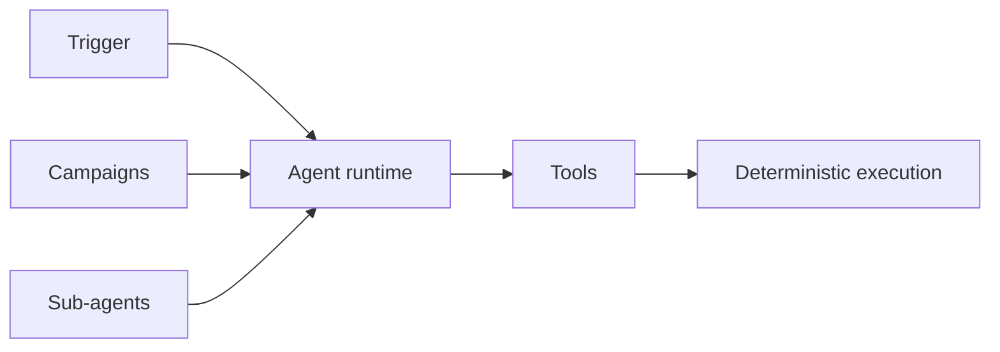

# Agent Orchestration

Agents run through one runtime. Campaigns, sub-agents, skills, and content pipelines work around it instead of competing with it.

## Who Owns What

- **The agent runtime** owns the conversation: thread events, run state, cancellation, input requests, streaming, the model, and the order of tool calls.
- **Campaigns** own recurrence, trigger rules, scheduling, and campaign memory. They start or resume agent runs through the runtime instead of acting as a second runtime.
- **Sub-agents** own delegation inputs and child-agent metadata, and call the runtime through its narrow interface.
- **Skills** are deterministic handlers for work such as trend discovery, content writing, and image generation. They sit below the tools and hold no conversation state.
- **The content engine** owns content plans, drafts, and review, and the **media pipeline** owns generation jobs and saving the assets. Neither is an agent state machine, and both can run in workers.

New automation, such as a campaign, a recurring job, or a CLI or MCP trigger, starts its work through the runtime. The path is always trigger, runtime, tools, then deterministic execution.

## Turn Context Assembly

One assembly path builds the context for a chat turn: scope, feedback memories, brand context layers, skills, model,
and system prompt. Two callers share it, so what a user inspects is what the
agent sees:

- the chat turn; and
- the read-only snapshot behind
  `GET /v1/brands/:brandId/agent-context`, the **Brand settings → Agent context**
  page, and the curated `get_brand_context` action (agent and MCP surfaces). The
  snapshot runs a threadless turn and persists nothing.

The brand layers the chat
path turns on are `brandIdentity`, `brandGuidance`, `brandMemory`,
`performancePatterns`, `recentPosts`, `ragContext`, and `brandKnowledge`; the
retrieval layers (`ragContext` and `brandKnowledge`) load only when the turn has
message text.

- `ragContext` retrieves saved brand context for the active brand. Only the brand's own context bases and
  organization-wide bases are eligible; personal Knowledge never is. It renders
  as `## Retrieved Brand Memory`.
- `brandKnowledge` uses ready chunks of
  `BRAND_TRUTH` Knowledge sources owned by the brand or shared org-wide. It
  renders as `## Brand Knowledge`. `INSPIRATION` and `RESEARCH` sources stay
  behind the explicit `search_knowledge` tool.
- Strategy topics render in the strategy section; voice writing rules and
  verbatim exemplar posts render in the voice section.

The prompt renderer fits the brand context to one character budget and reports
every section as kept, trimmed, or dropped. Reduction order, first to last:
retrieved brand memory, recent posts, historical performance, brand Knowledge,
general, custom instructions, guardrails, brand voice.

The assembled context is cached under the org-scoped `BRAND_CONTEXT` tag. Brand
updates, agent-config writes, brand-interview writes, and brand deletion
invalidate that tag.

## Model Cost

Each LLM round inside a turn reserves its maximum estimated cost from the model
registry before it runs. On a
self-hosted instance the provider key you configured pays for the call and
Genfeed does not bill you. Settlement metadata records model, token counts,
provider cost, and cost source, never prompt or completion text.

## External CLI Runtimes

Genfeed Desktop can run a turn on the user's own Claude Code or Codex CLI
(runtime keys `local/claude-cli` and `local/codex-cli`). The architecture is
CLI + Genfeed MCP + Desktop: Electron main spawns the CLI with only Genfeed MCP
tools allowed, the CLI reads brand context through `get_brand_context`, and
Desktop saves the finished turn with
`POST /v1/agent/threads/:threadId/external-turns`. The API records those turns
without reserving a model hold and keeps the CLI session id in
`AgentThread.config.externalRuntime` so the next turn resumes it. See the
[desktop README](https://github.com/genfeedai/genfeed.ai/blob/master/apps/desktop/README.md#agent-on-your-claude-code-or-codex-subscription).

## Boundary

Older modules with "orchestrator" or "executor" in the name still exist. What matters is that new work has one obvious path, and that none of them is treated as a peer runtime.
