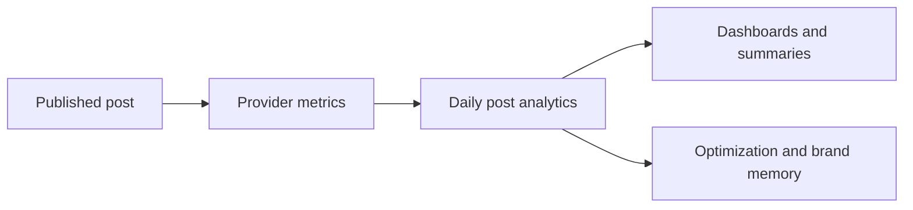

# Analytics Backbone

Analytics closes the content loop: published posts report back, and what they report shapes the next round of creation.

## What Each Part Does

- **Metric ingestion** pulls metrics from the connected provider for every published post that has a provider post id, for YouTube, TikTok, Instagram, X, and Pinterest. You can refresh one post or every published post of the organization. Each metric is stored once per post, platform, and day, so a refresh updates a day instead of adding a copy.
- **Publication analytics** answers "how did this post do now?" It shows the latest numbers for a post right away, including the current day.
- **Brand and organization analytics** roll the daily rows up into overviews, platform breakdowns, time series, and leaderboards.
- **Content performance** answers "what should the loop learn?" It reads complete past days only, because today's provider data is still incomplete, and produces weekly top and worst content, platform performance, the best posting times, top hooks, and the week-over-week trend.
- **Closed-loop sync** copies the selected metrics into a separate content-performance record. That copy feeds optimization and brand memory and never replaces the source rows.
- **Business analytics** aggregates usage and revenue for operator dashboards: totals, leaders, projections, and comparisons.

Other surfaces, such as the MCP server and agent goals, read these numbers but do not own the aggregation rules.

## Self-Hosted

On a self-hosted instance the whole path runs with your own provider credentials. A self-hosted deployment is single-tenant, so analytics adds no tenant-isolation rules of its own.

## Checking It

The verification path takes a representative provider metric through storage, confirms the publication summary shows it immediately, then moves the date window forward and confirms the same row appears in the weekly content-performance summary. It runs with mocked providers, so it needs no live credentials.
