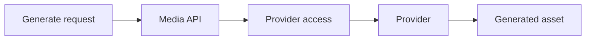

# Generation Service

Generation turns a prompt into an asset. The same path serves the agent, Studio, and Turbo runs.

## How A Request Flows

1. The agent tool, Studio, or a Turbo run sends a request to the media API for the asset type.
2. The media API validates it, picks a model from the reviewed model catalog, and records the asset.
3. Provider access resolves the key: the organization's own key first, the hosted key as the fallback.
4. A provider adapter calls Replicate, fal.ai, Leonardo, ElevenLabs, or OpenRouter and normalizes the result into one Genfeed asset shape.
5. The asset returns as a preview card or lands in the Library when it finishes.

New models found on verified provider accounts enter an inactive review queue. Nothing generates with a model until it has been reviewed and activated.

## Agent Tools

The stable tools an agent can call to create generation work:

| Tool                     | Input                                                                                                                                                                                                                  | Result                                                        |
| ------------------------ | ---------------------------------------------------------------------------------------------------------------------------------------------------------------------------------------------------------------------- | ------------------------------------------------------------- |
| `generate`               | `type` (`image`, `video`, `voice`, `music`) and `prompt`; optional `model` (the router picks when omitted), plus per-type fields such as `aspectRatio`, `duration`, `imageUrl` and `audioUrl` (avatar video) or `voiceId`. A field for another type is rejected | A preview card with the asset id and gallery link (voice: voice id or audio URL) |
| `generate_turbo_content` | `count`, `platforms`; optional `brandId`, `handle`, `dateRange`, `contentMix`, `style`, `topics`                                                                                                                       | A Turbo run id with review queue and status actions           |
| `generate_as_identity`   | `text` for the identity avatar to speak                                                                                                                                                                                | A processing preview card for the avatar video                |

Depend on these names. Workflow step categories such as `generate-image` and `generate-music` belong to the workflow engine and are not agent tool names.

The agent's generation card starts from default aspect ratio, model, and duration for images and video, which you review before it runs.

## Skills

Content skills such as `image-generation` run a reviewed, immutable workflow. A skill that is not in the reviewed catalog is rejected. For images, the organization's key picks the provider, a configured managed key routes through managed inference instead, and a provider capacity error fails over between Replicate and fal.ai rather than failing the draft.

## Checking It

The verification path runs a skill through workflow dispatch and the image path with mocked providers, so it needs no live credentials. It does not call fal.ai or Replicate, covers one representative image path rather than every media type, and leaves billing, rate limits, and provider callbacks to provider-specific tests and manual release checks.

For the provider contract, see [Provider Registry](/self-host/provider-registry).
