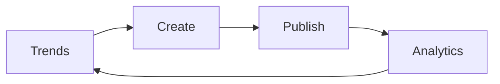

# Core Loop

Genfeed is organized around one operating loop:

`trends -> create -> publish -> analytics -> repeat`

In the product navigation, **Create** is the parent phase for Studio, Remix, Library, and Turbo. Remix and generation stay visible, but they sit under the same creation phase instead of becoming separate first-level app surfaces.

## What This Section Covers

- **[Trend Ingestion](/core-loop/trend-ingestion)**: how trend signals enter the platform, how fresh they are, and how the refresh is monitored
- **[Agent Orchestration](/core-loop/agent-orchestration)**: how one agent runtime owns a conversation while campaigns, skills, and content pipelines stay deterministic layers around it
- **[Generation Service](/core-loop/generation-service)**: how a request for an image, video, voice, or track reaches a provider and comes back as an asset
- **[Analytics Backbone](/core-loop/analytics-backbone)**: how provider metrics become dashboards and feed back into the next round of creation

## Checking The Loop

Each area has one narrow check that proves it is wired:

- **Trends**: with an empty cache, a read falls through to a live fetch, and it returns an empty feed when there is no real data (never synthetic seed data)
- **Agents**: new automation starts its work through the one agent runtime instead of adding another peer orchestrator
- **Generation**: models discovered from providers merge into the reviewed model catalog before anyone can generate with them
- **Analytics**: provider metrics are stored per post and day, show in publication analytics at once, and join the content-performance summaries once the day is complete
