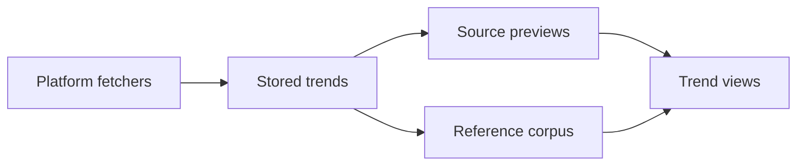

# Trend Ingestion

Trends are the first step of the loop: public signals from each platform, stored with a freshness window so the rest of the product can read them.

## Discovery feeds and playable content

Discovery separates account-curated feeds from public trend observations:

- **Following** lives at `/<organization>/<brand>/discovery/following`.
  Existing `discovery/overview?source=following` links redirect there. Connected
  accounts appear automatically; users do not need to enter their follows again.
  Refresh collects X's reverse-chronological home timeline and recent videos from
  YouTube subscriptions. YouTube collection is bounded to 200 subscriptions and
  five recent uploads per channel. Other networks show their current API
  limitations and a link to the native feed.
- **Trends** defaults to public market observations. The brand relevance filter
  is an explicit option; Overview keeps its brand relevance behavior. Video
  cards and topic examples have click-to-play controls. Sound cards retain
  available audio metadata and example videos using that sound. Missing or
  expired media keeps a source link instead of a pretend play control.
- Hashtag and sound counts derived from collected videos say **observed**.
  Growth without a measured comparison window says **not measured**. These
  samples are not platform-wide popularity totals.

Following actions use the selected connected account: X supports likes, replies,
reposts and quotes; YouTube supports likes and comments when granted permissions
allow them. A durable action receipt reserves each idempotency key before calling
the provider. If publication cannot be confirmed, the UI asks the user to check
the source rather than automatically publishing again. Apply the
`20261008160000_source_post_native_actions` Prisma migration before enabling these
actions.

Public collection and account feeds have separate health evidence. Authentication,
API access, rate limits and provider budget failures remain actionable; hiding
them would not restore ingestion. Apify can supply public content and media
metadata, but does not provide native account permissions. Actor availability,
provider account balance and credential access must also be healthy for live collection.

## How Trends Are Stored

- A read first checks the active trends for the organization and brand. With nothing cached it fetches live, stores one current trend per provider result, and enriches the result with source previews.
- Each trend carries its platform, topic, mentions, growth rate, a calculated virality score, and an expiry. Trends fetched for a brand expire sooner than the shared global ones.
- When a trend expires or is refreshed by hand, it is marked historical, never deleted, so analysis can still look back.
- Trends also feed the reference corpus that creation draws on, and the trend cache is cleared after each fetch so readers see the new result.
- Provider coverage differs by platform: public fetchers cover TikTok, Instagram, YouTube, Reddit, and Pinterest, X has its own discovery path, and LinkedIn has its own. Not every platform has native API access in open source.

## Refresh evidence and ingestion health

`GET /trends/corpus/health` reads saved corpus data and refresh receipts. Its
`refreshHealth` entries contain platform, dataset, global/scoped source,
`lastAttemptAt`, `completedAt`, `lastSuccessfulRefreshAt`, outcome and a fixed
reason code. Tenant reads include their own receipts and the public corpus.
There are no provider calls, queue submissions or health writes on this GET.

The existing system-workflow node results only retained dataset counts; zero
could mean empty, failed, or fallback, and manual refreshes have no workflow
execution. Refresh receipts therefore use the existing operational event journal
(`NotificationEvent`, source type `trend_refresh_health`) with no deliveries.
This requires no schema migration. Provider responses and credential details are
never stored in the receipt. Cache hits do not create new attempts. A completed
empty response counts as a successful refresh; unavailable native credentials and
provider or persistence failures do not. Successful fallbacks are explicitly
identified. Source health displays real timestamps, distinguishes never-successful
attempts, and keeps missing observations separate from refresh evidence.

The scheduled maintenance entry point checks two fully closed 12-hour windows
aligned to 00:15/12:15 UTC before queuing the next refresh. A durable enrollment
record gives new deployments two windows of grace. Each missing platform/dataset
gets one actionable operator alert through the durable notification outbox;
continued misses share an incident key. The next successful refresh produces a
recovery on the next scheduled health check and allows a later incident to alert
again. Alert delivery failures cannot stop collection. Connected scopes are checked separately from the public corpus, so global fallback
success cannot conceal a failed connected provider. Health alert messages and
metrics carry no tenant identifiers; scoped incident keys use opaque fingerprints.
