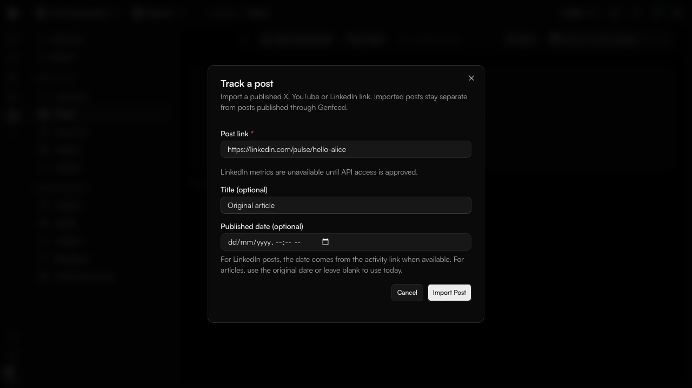

# Track posts published outside Genfeed

Select a brand, open **Analytics → Posts**, and choose **Track a post**.
Paste the publication's HTTPS link and select **Import post**.

X and YouTube imports read the original text or title, publication date and
author through the platform API. If exactly one connected account matches the
author, Genfeed links that account and schedules analytics collection. Otherwise
the post stays saved and asks you to connect the original account.

LinkedIn posts and articles are saved without metrics until API access is
approved. You may supply a title and publication date. Activity links encode a
date; articles use your supplied date or today. Genfeed does not scrape LinkedIn
or guess a share/ugcPost identifier from an activity identifier.

Imported posts have an **Imported** badge and source filter in Analytics and
Publishing. Imports waiting for collection or without metrics remain visible
within the selected date range. Unavailable metrics are labeled rather than
displayed as measured zeroes. Importing a link again opens the existing post.

The authenticated endpoint is `POST /posts/track-link`, with
`{ brandId, url, title?, publishedAt? }`. The agent and MCP action is
`track_post_link` in the analytics toolset. Both use the same importer.

This flow imports individual links. Full account-history import and manual
LinkedIn metrics are outside this flow.

LinkedIn API references: [Posts API](https://learn.microsoft.com/en-us/linkedin/marketing/community-management/shares/posts-api)
and [Member Post Statistics](https://learn.microsoft.com/en-us/linkedin/marketing/community-management/members/post-statistics).
